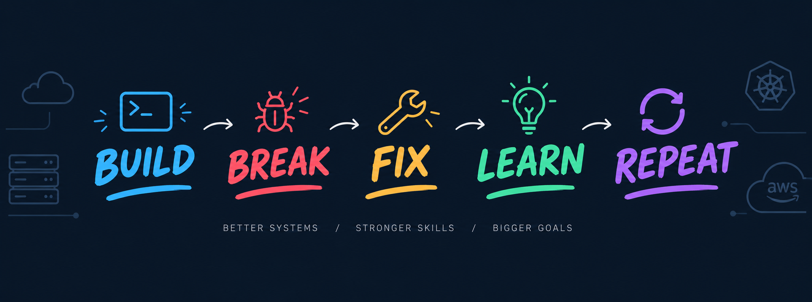

<!--

-->

<!--**muhammadiishaq/muhammadiishaq** is a ✨ _special_ ✨ repository because its `README.md` (this file) appears on your GitHub profile.

Here are some ideas to get you started:

- 🔭 I’m currently working on ...
- 🌱 I’m currently learning ...
- 👯 I’m looking to collaborate on ...
- 🤔 I’m looking for help with ...
- 💬 Ask me about ...
- 📫 How to reach me: ...
- 😄 Pronouns: ...
- ⚡ Fun fact: ...
-->

 <body>
  

    <h1> Hi there, I'm Muhammad Ishaq<a href="#d">   
</h1>
  

   
  

  

	
# 💫 About Me
Hi, I'm Muhammad Ishaq — a passionate DevOps Engineer in the making! I'm currently studying and building hands-on experience in modern cloud-native DevOps tools and practices, from CI/CD pipelines to cloud infrastructure, container orchestration, and infrastructure as code.
techwithishaq 
---

# 🌐 Connect With Me
 

 
 
  
 
 
 

---
### Profile Views..

  

---

---

# 💼 DevOps Tech Stack & Programming Skills

| **Category** | **Tools** |
|--------------|-----------|
| 🐳 **Containers & Orchestration** |   |
| ☁️ **Cloud Platforms** |    |
| 🛠️ **CI/CD & Automation** |     |
| ⚙️ **IaC & Config Mgmt** |    |
| 🧠 **Monitoring & Observability** |         |
| 🌐 **Web & Servers** |    |
| 💽 **Databases** |    |
| 💻 **Programming Languages** |  )    |

---

<!-- ## 🏆 GitHub Trophies

-->

## 💡 Favorite Quote

<!--
# ✍️ Random Dev Quote

--

<!---## 🔝 Top Contributed Repo

-->
---

<picture>
  <source media="(prefers-color-scheme: dark)" srcset="https://raw.githubusercontent.com/muhammadiishaq/muhammadiishaq/output/github-snake-dark.svg" />
  <source media="(prefers-color-scheme: light)" srcset="https://raw.githubusercontent.com/muhammadiishaq/muhammadiishaq/output/github-snake.svg" />
  
</picture>

 <h2>GitHub Analytics
 </h2>

 
   

<!-- 

  
  

 -->

